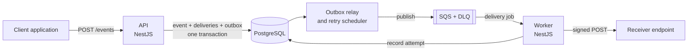

# Webhook Delivery Service

A reliable webhook delivery service built with TypeScript, NestJS, PostgreSQL and AWS SQS. Applications register endpoints and publish events through a REST API; the service delivers them to subscriber URLs with **at-least-once** semantics, signed requests, retries with exponential backoff and jitter, and a full history of every delivery attempt.

> **Status:** work in progress. This README describes the target design. Commands, benchmark numbers and the deployment section are filled in as each milestone is completed; anything marked `TBD` has not been measured yet.

## Why this project exists

Sending a webhook is easy. Sending it reliably is not: receivers are slow, return errors, go offline, or get misconfigured. This service focuses on the hard part, which is what happens when delivery fails:

- no event is lost once it has been accepted by the API,
- failed deliveries are retried on a defined schedule,
- one broken receiver cannot starve the others,
- every attempt is recorded and can be replayed.

## Features

- REST API for registering endpoints and publishing events
- At-least-once delivery with idempotency keys on publish and a stable event ID on every delivery
- Retries with exponential backoff and jitter, dead-letter handling and manual replay
- HMAC-SHA256 request signing with timestamps (replay protection on the receiver side)
- Transactional outbox: events and delivery records are written in one database transaction
- Per-endpoint circuit breaker that disables endpoints after repeated failures
- SSRF protection for receiver URLs
- Metrics, structured logs and traces (OpenTelemetry)
- Infrastructure as code (Terraform) and CI (GitHub Actions)

## Architecture



| Component | Responsibility |
|---|---|
| **API** | Accepts events, manages endpoints and API keys, exposes delivery history |
| **PostgreSQL** | Source of truth for endpoints, events, deliveries, attempts and the outbox |
| **Outbox relay / scheduler** | Publishes outbox rows to SQS and enqueues deliveries whose `next_attempt_at` is due |
| **SQS + DLQ** | Decouples accepting events from delivering them |
| **Worker** | Signs and sends HTTP requests, records each attempt, schedules retries |
| **Receiver simulator** | Test target with configurable failure modes (slow, 5xx, random errors) |

### Delivery flow

1. A client publishes an event with `POST /events` and an idempotency key.
2. In a single transaction the API stores the event, one delivery per matching endpoint, and the outbox entries.
3. The outbox relay publishes the entries to SQS and marks them as published.
4. A worker picks up a delivery job, signs the payload and sends it with a timeout.
5. A `2xx` response completes the delivery. Any other outcome (timeout, network error, non-2xx) schedules the next attempt.
6. When all attempts are exhausted the delivery moves to `failed` and can be replayed manually.
7. After a configurable number of consecutive failures the endpoint is disabled automatically.

### Delivery semantics

The service guarantees **at-least-once** delivery. Exactly-once delivery is not achievable over an unreliable network, so every request carries a stable event ID (`X-Webhook-Id`) that receivers should use to deduplicate.

### Retry schedule

Default schedule (configurable), applied with jitter:

| Attempt | Delay after previous failure |
|---|---|
| 1 | immediate |
| 2 | ~5 s |
| 3 | ~30 s |
| 4 | ~2 min |
| 5 | ~10 min |
| 6 | ~1 h |
| 7 | ~6 h |

After the last attempt the delivery is marked `failed`.

## Data model

| Table | Purpose |
|---|---|
| `applications`, `api_keys` | API clients; keys are stored as hashes |
| `endpoints` | Receiver URL, encrypted signing secret, status, event type filter |
| `events` | Event type, JSON payload, unique idempotency key per application |
| `deliveries` | One row per event and endpoint: status, attempt count, `next_attempt_at`, last error |
| `delivery_attempts` | Timing, HTTP status, response snippet and error for every attempt |
| `outbox` | Entries waiting to be published to the queue |

## API

All endpoints require an API key (`Authorization: Bearer <key>`).

| Method and path | Description |
|---|---|
| `POST /endpoints` | Register a receiver endpoint |
| `GET /endpoints` | List endpoints |
| `PATCH /endpoints/:id` | Update or disable an endpoint |
| `POST /endpoints/:id/rotate-secret` | Rotate the signing secret |
| `POST /events` | Publish an event (idempotency key required) |
| `GET /events/:id/deliveries` | Delivery status and attempt history for an event |
| `POST /deliveries/:id/replay` | Retry a failed delivery manually |
| `GET /health` | Health check |
| `GET /metrics` | Prometheus metrics |

Interactive API documentation is served at `/docs` (Swagger) when the API is running.

## Verifying signatures (receiver side)

Every request includes:

| Header | Value |
|---|---|
| `X-Webhook-Id` | Stable event ID, use it to deduplicate |
| `X-Webhook-Timestamp` | Unix timestamp (seconds) of the attempt |
| `X-Webhook-Signature` | `v1=<hex>`, HMAC-SHA256 of `{id}.{timestamp}.{body}` with the endpoint secret |

Example verification in TypeScript:

```ts
import { createHmac, timingSafeEqual } from 'node:crypto';

const TOLERANCE_SECONDS = 300;

export function verifyWebhook(
  secret: string,
  headers: Record<string, string>,
  rawBody: string,
): boolean {
  const id = headers['x-webhook-id'];
  const timestamp = headers['x-webhook-timestamp'];
  const signature = headers['x-webhook-signature'];
  if (!id || !timestamp || !signature) return false;

  // Reject requests that are too old (replay protection).
  const age = Math.abs(Date.now() / 1000 - Number(timestamp));
  if (!Number.isFinite(age) || age > TOLERANCE_SECONDS) return false;

  const expected = createHmac('sha256', secret)
    .update(`${id}.${timestamp}.${rawBody}`)
    .digest('hex');

  const received = signature.replace(/^v1=/, '');
  const a = Buffer.from(expected, 'hex');
  const b = Buffer.from(received, 'hex');
  return a.length === b.length && timingSafeEqual(a, b);
}
```

## Security

- **SSRF protection:** receiver URLs pointing to private ranges, loopback and cloud metadata addresses are rejected. DNS is re-resolved at delivery time, not only at registration.
- **Signed requests** with a timestamp so receivers can reject replays.
- **Secrets at rest:** endpoint signing secrets are stored encrypted. API keys are stored as hashes.
- **Limits:** maximum payload size and rate limiting on the API.

## Observability

- **Metrics:** delivery latency, success rate, queue depth, retry counts (Prometheus format at `/metrics`)
- **Tracing:** OpenTelemetry traces across API, relay and worker
- **Logs:** structured JSON with a correlation ID per event

## Tech stack

TypeScript, NestJS, PostgreSQL, AWS SQS, Docker, Terraform, GitHub Actions, k6, OpenTelemetry. Local development uses Docker Compose with LocalStack in place of AWS.

## Getting started

> Commands below describe the target setup and will be verified when the project is runnable.

Prerequisites: Node.js (current LTS), pnpm, Docker with Compose.

```bash
# Clone the repository
git clone https://github.com/StaZarycki/<repository-name>.git
cd <repository-name>

# Install dependencies
pnpm install

# Start PostgreSQL, LocalStack (SQS) and the receiver simulator
docker compose up -d

# Run database migrations
pnpm migration:run

# Start the API and the worker
pnpm start:api
pnpm start:worker
```

### Try it

```bash
# Register an endpoint
curl -X POST http://localhost:3000/endpoints \
  -H "Authorization: Bearer $API_KEY" \
  -H "Content-Type: application/json" \
  -d '{"url": "http://localhost:4000/hook", "eventTypes": ["order.created"]}'

# Publish an event
curl -X POST http://localhost:3000/events \
  -H "Authorization: Bearer $API_KEY" \
  -H "Idempotency-Key: demo-0001" \
  -H "Content-Type: application/json" \
  -d '{"type": "order.created", "payload": {"orderId": 42}}'
```

## Testing

```bash
pnpm test           # unit tests
pnpm test:int       # integration tests (Testcontainers for PostgreSQL, LocalStack for SQS)
pnpm test:e2e       # end-to-end tests against the receiver simulator
```

Key scenarios covered: idempotent publishing, retry schedule, signature verification, endpoint auto-disable, manual replay.

## Load testing

Load tests use [k6](https://k6.io/). Scenarios:

1. **Normal traffic:** all receivers healthy
2. **Failing receiver:** 50% of requests return an error
3. **Slow receiver:** responses delayed beyond the delivery timeout

| Scenario | Throughput | p95 delivery latency | Notes |
|---|---|---|---|
| Normal traffic | TBD | TBD | TBD |
| Failing receiver | TBD | TBD | TBD |
| Slow receiver | TBD | TBD | TBD |

Test environment and raw results will be added here once measured.

## Deployment

Infrastructure is defined with Terraform: SQS with a dead-letter queue, ECR, ECS Fargate services for the API and worker, RDS PostgreSQL, Secrets Manager and CloudWatch.

> The AWS environment is created for demonstrations and destroyed afterwards to keep costs low. Set up an AWS budget alert before applying.

```bash
cd infra
terraform init
terraform plan
terraform apply
```

## Design decisions

Architecture decision records live in [`docs/adr`](docs/adr):

- Transactional outbox vs publishing directly to the queue
- SQS vs RabbitMQ
- Database-driven retry scheduler vs SQS delay (SQS delays are capped at 15 minutes)
- At-least-once delivery and receiver-side deduplication

## Roadmap

- [ ] Core API, schema and CI
- [ ] Worker, queue integration and request signing
- [ ] Retries, dead-letter handling and idempotency
- [ ] Outbox pattern, circuit breaker and rate limiting
- [ ] Terraform and AWS deployment
- [ ] Observability and load test report
- [ ] Optional: delivery worker rewritten in Go for a throughput comparison

## License

MIT